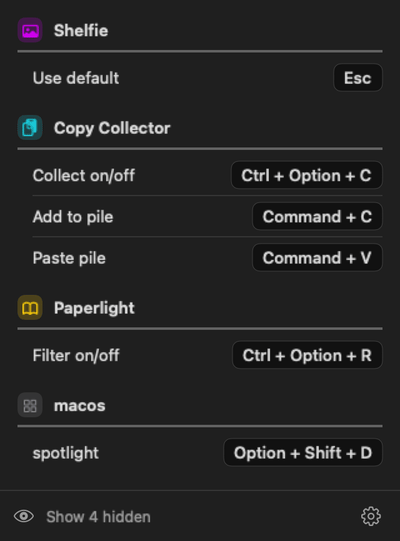

# Keyper


**A tiny Mac menu bar app that keeps the hotkeys you use in one list, grouped by app.**



### [⬇️ Download Keyper](https://github.com/hi-dad/keyper/releases/latest/download/Keyper.dmg)
Free · macOS 14 or newer · no permissions, no account, offline

## Install

1. Open **Keyper.dmg** and drag Keyper into **Applications**.
2. Open it, and click **Open** when macOS asks if you're sure. (It's signed and checked by Apple.)

A keycap with ⌘ appears in your menu bar. Can't see it? Look behind any « arrow in a full menu bar.

## How to use

- **Your shortcuts, one section per app.** Keyper finds hotkeys it can read on its own (App Shortcuts you set in System Settings, and apps that save their hotkeys the common way).
- **Add the rest yourself** in Settings (gear): **+ Add shortcut** inside any section, or **+ New section** for an app or topic of your own, like Screenshots.
- **Settings** also lets you favorite, rename, hide and reorder, pick icons and colors, and choose how keys look (⌘, Command or Cmd; one tile or one per key; text size).

Keyper only reads settings files and never changes a hotkey. It re-reads them every time you open it.

**Updates:** it offers new versions itself (or Settings → **Check for Updates…**). **Remove:** Settings → **Quit Keyper**, then drag it to the Trash.

<details><summary>Build it yourself</summary>

Needs Xcode or the Command Line Tools.

```bash
./build.sh     # builds, installs to Applications and opens it
```

`Keyper --render out.png --page mine|mac|settings` draws the panel to a picture.

Apps can list their own hotkeys for Keyper in `~/Library/Application Support/Keyper/Apps/<name>.json`
(format in `Sources/Keyper/Scanner.swift`).

</details>

MIT License
